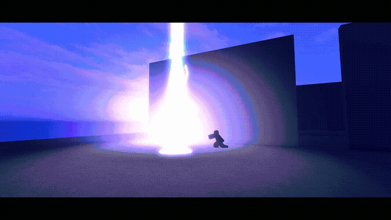

# waku-vfx-roblox

[](media/wakuVFX_trailer.mp4)

**[Watch the trailer](media/wakuVFX_trailer.mp4)** · [Download the MP4](media/wakuVFX_trailer.mp4?raw=true)

Four editable, client-side Roblox combat effects from **Waku Worldwide**. Built from parts, beams, particles and procedural R15 poses, with no mesh or animation uploads required. GitHub may offer the trailer as a download rather than an inline player.

| Effect | Motion |
|---|---|
| **PrismCleave** | Starburst charge, rainbow rings and a dash-slash |
| **CrystalBloom** | Crystal swirl, star bloom, white-out and shatter |
| **StormLance** | Charged stab and three rainbow lightning pillars |
| **EarthRise** | Clap, ground slam, rising voxel pillars and crumble |

## Included

- All four effect modules, shared runtime, R15 pose code and demo controls.
- `wakuVFX_demo.rbxlx`, plus demo and library-only Rojo projects.
- All **16 PNG textures**, their manifest and editable Python generator.
- [A runnable new-effect walkthrough](docs/NEW_EFFECT.md), optional assistant skill and [test instructions](TESTS.md).
- The supplied trailer. Capture, trailer editing and audio production tools are not part of this source kit.

## Quick start

1. Open `wakuVFX_demo.rbxlx` in Roblox Studio.
2. **Upload your own copies of the included textures and replace the IDs**, as below.
3. Use an R15 avatar, press **Play**, then **1 / 2 / 3 / 4**. Gamepad: X / Y / B / A. Touch: on-screen buttons.

To use the kit in an existing game, copy **the `ReplicatedStorage.wakuVFX` ModuleScript with all its children** from the demo. It is not a plain Folder. Call it from a LocalScript:

```lua
local Players = game:GetService("Players")
local waku = require(game.ReplicatedStorage.wakuVFX)
local character = Players.LocalPlayer.Character or Players.LocalPlayer.CharacterAdded:Wait()
local hrp = character:WaitForChild("HumanoidRootPart")
local handle = waku.play("PrismCleave", hrp.CFrame, { caster = character })
-- To cancel later (do not stop immediately after play):
-- if handle then handle.stop() end
-- Alternative: waku.play("StormLance", hrp.CFrame, { caster = character })
-- EarthRise expects a ground CFrame facing the eruption direction.
```

One active pose owns each caster. A second overlapping posed call returns `nil`, warns and records a build error; it does not interrupt the first. Stop the first handle or wait until `handle.alive()` is false before starting the next. Different casters can run concurrently. CrystalBloom does not pose a caster.

These are visuals, not damage, authoritative movement or replication. PrismCleave moves a clone; the real character returns in place. Implement server-validated gameplay and client effect dispatch in your own game.

### Options, without changing the art

| Effect | `scale` | `rainbow` / `hue` | `caster` | `grade=false` |
|---|---|---|---|---|
| PrismCleave | Authored size scaling | Base palette controls | R15 pose | Not used |
| CrystalBloom | Authored size scaling | Base palette controls | Not used | Disables scene tint |
| StormLance | Authored size scaling | Base palette controls | R15 pose | Disables scene tint |
| EarthRise | Ignored | Ignored; always rainbow | R15 pose | Not used |

`rainbow=false` stops base-hue time cycling; spatial rainbow offsets remain. `hue=0.55` is a palette offset, **not a uniform fixed colour**. Scaling is authored per effect, not a universal character/world transform. `seed` controls seeded variation (default 7). `waku.timeScale` is nil/1 for normal playback, 0.5 for slow motion, 0 for screenshots. There is no shipped fixed-step capture API.

## Upload your textures and replace IDs

The existing IDs are reference values, not a promise of access in your experience. You upload assets yourself; this repository does not upload or change Roblox permissions.

1. Upload every `textures/*.png` under the user/group that owns your target experience using Studio Asset Manager or Creator Hub.
2. Obtain each uploaded **image content ID**, not a decal/container ID. If Roblox creates a Decal, inspect its `Texture` property to get the image URI.
3. Replace the matching named values in `src/wakuVFX/Assets.luau` with `rbxassetid://YOUR_IMAGE_ID`. The manifest pairs texture keys with PNGs; update its ID records too if maintaining your own copy.
4. **Loose files and the built demo are separate copies.** Rebuild the demo with Rojo (below), or directly edit the `Assets` child ModuleScript inside `ReplicatedStorage.wakuVFX` in Studio and save the place. Editing a loose file does not change an already-open demo.
5. Stop and restart Play after edits. Run the client SelfTest in [TESTS.md](TESTS.md) to check your own IDs and caster restoration.

## Build and author

Studio alone is enough to copy and edit modules. For a reproducible file-based workflow, install the **Rojo 7.7.1 CLI** from [Rojo releases](https://github.com/rojo-rbx/rojo/releases/tag/v7.7.1) and the matching Studio plugin following [Rojo installation](https://rojo.space/docs/v7/getting-started/installation/). Put `rojo` on PATH, then run from this folder:

```sh
rojo --version
rojo build demo.project.json -o wakuVFX_demo.rbxlx
rojo build library.project.json -o wakuVFX_library.rbxlx
```

The library project maps only the wakuVFX ModuleScript and children under ReplicatedStorage, preserving unknown instances; its build is a minimal place, not the demo. Alternatively, `rojo serve library.project.json` and connect using the Studio Rojo plugin at localhost:34872; inspect the proposed sync before accepting. **Do not sync `demo.project.json` into an existing game**: it also owns demo controls, Workspace and Lighting. Use the demo mapping only in a disposable demo place.

Texture generation requires Python **3.11+**, NumPy and Pillow. Tested pins are in `requirements.txt`:

```sh
python -m venv .venv
# macOS/Linux:
. .venv/bin/activate
# Windows PowerShell instead: .venv\Scripts\Activate.ps1
python -m pip install -r requirements.txt
python tools/gen_textures.py textures
```

The generator reproduces all 16 supplied textures. To make your first visible effect, follow [NEW_EFFECT.md](docs/NEW_EFFECT.md). No assistant is required; `skill/wakuvfx/SKILL.md` is optional.

## License

Code and documentation: **[MIT](LICENSE)**, copyright Waku Worldwide.
Owned generated textures in `textures/`: **[CC BY 4.0](LICENSE-TEXTURES.md)**, attribution **“wakuVFX textures by Waku Worldwide”**. You may modify and commercially reuse those licensed files under their respective terms. Roblox accounts, original hosted assets and group access are not transferred.

The supplied trailer is included for preview, separately from the code and texture grants. See [NOTICE.md](NOTICE.md).
