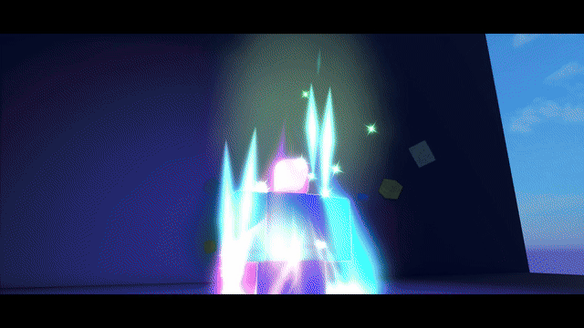

# Set 2: five more combat effects

[](../media/set-2-trailer.mp4)

**[Download the 30-second trailer](../media/set-2-trailer.mp4?raw=true)** · [Back to the full kit](../README.md) · [Download the repository](https://github.com/retrospec13/waku-vfx-roblox/archive/refs/heads/main.zip)

Set 2 is part of the same kit. All four Set 1 effects remain included.

## Effects and demo keys

- **5: ChargeAura.** Charge-up, ignition and a body aura. Press again to stop. The default effect ends after three seconds.
- **6: HitBurst.** A short contact flash, spikes, ring and sparks. Change `seed` for each combo hit.
- **7: ChargeBeam.** A hand charge followed by a thick beam. A raycast sets the endpoint, up to 70 studs away.
- **8: GhostDash.** Five pose afterimages and a speed trail. The effect does not move the player. The demo adds local movement for testing.
- **9: ImpactFlash.** Black/white impact frames followed by a colour burst. Pass `grade = false` to skip the full-screen flash.

**Flashing-light warning:** ImpactFlash uses rapid contrast changes. Disable its grade for players who need reduced flashes.

## Get started

1. Download the repository ZIP and extract it.
2. Open [`wakuVFX_demo.rbxlx`](../wakuVFX_demo.rbxlx) in Roblox Studio.
3. Upload the supplied [textures](../textures) under your experience owner. Replace the texture IDs in the demo's `ReplicatedStorage.wakuVFX.Assets`. See the [full texture setup](../README.md#upload-your-textures-and-replace-ids).
4. Use an R15 avatar and press Play. Keys 5 through 9 run Set 2. Keys 1 through 4 still run Set 1. Set 2 demo controls are keyboard-only.
5. To use the kit in your game, copy the whole `ReplicatedStorage.wakuVFX` ModuleScript with its children. Call it from a LocalScript.

```lua
local Players = game:GetService("Players")
local waku = require(game.ReplicatedStorage.wakuVFX)
local character = Players.LocalPlayer.Character or Players.LocalPlayer.CharacterAdded:Wait()
local root = character:WaitForChild("HumanoidRootPart")

-- Choose one call for the action you are implementing.
local aura = waku.play("ChargeAura", root.CFrame, { caster = character })
-- Later: if aura then aura.stop() end

-- Contact effects use a CFrame facing along the blow.
-- local contact = root.Position + root.CFrame.LookVector * 3
-- local hitCF = CFrame.lookAt(contact, contact + root.CFrame.LookVector)
-- waku.play("HitBurst", hitCF, { seed = 2 })
-- waku.play("ImpactFlash", hitCF, { caster = character, grade = false })
-- waku.play("ChargeBeam", root.CFrame, { caster = character })
-- waku.play("GhostDash", root.CFrame, { caster = character })
```

These effects do not implement damage, network replication or server movement. ChargeBeam uses the kit's shared caster-pose lock. Wait for a posed effect to end or stop its handle before starting another on the same caster.

## ElevenLabs SFX and playback

The owner's ElevenLabs sounds are included as editable MP3 files:

- [`audio/el/`](../audio/el): source sound variants.
- [`audio/mix/`](../audio/mix): prepared Set 2 sound clips.
- [`Sounds.luau`](../src/wakuVFX/Sounds.luau): optional spatial playback, used by the demo.

Upload the audio under your experience owner and give the experience access. Fill `Sounds.IDs` with the resulting `rbxassetid://...` values. The default blank IDs keep playback silent until configured. Edit the module inside the demo, or edit the loose source and rebuild the place.

File mapping:

- ChargeAura: `audio/mix/s2_aura.mp3`
- HitBurst: `audio/mix/s2_hit.mp3`
- ChargeBeam: `audio/mix/s2_beam.mp3`, delayed 0.45 seconds after the cast
- GhostDash: `audio/mix/s2_dash.mp3`
- ImpactFlash: `audio/mix/s2_impact.mp3`

The other clips are available for your own layering and timing. Audio is not tied to `waku.timeScale`; the helper uses real-time playback. The helper plays one-shots, not an aura loop.

For your own controls, call the audio helper after a successful visual cast:

```lua
local sounds = require(game.ReplicatedStorage.wakuVFX.Sounds)
local handle = waku.play("ChargeBeam", root.CFrame, { caster = character })
if handle then sounds.play("ChargeBeam", root, handle) end
```

## Source, builds and reuse

- [Five effect modules and shared runtime](../src/wakuVFX)
- [Demo controls](../src/demo/wakuDemo.client.luau)
- [Demo Rojo project](../demo.project.json) and [library-only project](../library.project.json)
- [Texture source and generator instructions](../README.md#build-and-author)
- [Test instructions and limits](../TESTS.md)

Code: [MIT](../LICENSE). Textures: [CC BY 4.0](../LICENSE-TEXTURES.md). Included ElevenLabs SFX: [reuse grant](../LICENSE-AUDIO.md). The trailer contains promotional camera shots as well as Studio footage; it is not a promise that every shot is a gameplay camera.
