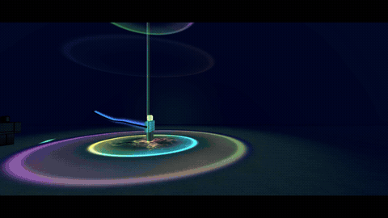

# Set 3: five over-the-top combat effects

[](../media/set-3-trailer.mp4)

**[Download the 30-second full-quality trailer](../media/set-3-trailer.mp4?raw=true)** · [Back to the full kit](../README.md) · [Set 2](SET-2.md) · [Download the repository](https://github.com/retrospec13/waku-vfx-roblox/archive/refs/heads/main.zip) · [Production pipeline](PIPELINE.md)

Set 3 is part of the same kit. The nine earlier effects are unchanged. All five are client-side, built only from
the kit's existing 16 textures, and parent everything under the effect's own model, so cleanup is automatic.

## Effects and demo keys

- **Z: QuakeSlam** (1.9 s). A comet of pressure falls on the point, then a white-out slam: a light pillar through
  three sky rings, a pressure dome, shock rings, a wall of dust, a star of glowing cracks, black lightning and
  thrown rock that tumbles back down. `cf` is the slam point (it drops to the ground below). No caster.
- **X: BlinkStep** (0.85 s). The body whites out into a thin seam of light, is hidden for the gap, and returns under
  a lightning pillar with shock rings and cracked ground. Visuals only: your game moves the character.
- **C: RiftGate** (4.7 s, or until stopped). Two sparks burn the rim in, the ring snaps open, and a swirling portal
  holds with comets chasing round the rim. Press again to fold it shut.
- **V: WardShell** (3.4 s, or until stopped). A lattice bubble snaps open round the caster, takes two hits that crack
  it, then shatters into shards. Press again to burst it early.
- **B: Fireball** (1.6 s). Charge flare, a house-sized fireball with a long flame tail, and a fire-dome explosion on
  the first thing it hits within 60 studs.

**Flashing-light warning:** QuakeSlam, BlinkStep and Fireball have a short full-brightness flash at the impact.

## Get started

1. Download the repository ZIP and extract it.
2. Open [`wakuVFX_demo.rbxlx`](../wakuVFX_demo.rbxlx) in Roblox Studio.
3. Upload the included [textures](../textures) under **your own** experience owner. Replace the texture IDs in `ReplicatedStorage.wakuVFX.Assets`. See [texture setup](../README.md#upload-your-textures-and-replace-ids).
4. Use an R15 avatar and press Play. Keys Z, X, C, V and B play Set 3. Keys 1 through 9 still play the earlier sets. These new demo keys are keyboard-only.
5. To use the kit in your own game, copy the whole `ReplicatedStorage.wakuVFX` ModuleScript with its children. Call it from a LocalScript.

These effects supply visuals only. Your game owns movement, damage and network replication.

## Calling them

```lua
local waku = require(game.ReplicatedStorage.wakuVFX)

waku.play("QuakeSlam", CFrame.new(groundPos))

-- BlinkStep: pass where the root is going, then move the character yourself during the 0.16-0.31 s gap.
waku.play("BlinkStep", root.CFrame, { caster = character, to = arrivePos })
task.delay(0.2, function() root.CFrame = root.CFrame.Rotation + arrivePos end)

-- cf is the gate's centre; LookVector is the way it faces, UpVector its top (it can lean or lie flat).
local gate = waku.play("RiftGate", CFrame.lookAt(centre, centre + facing))
-- Later: gate.stop() plays the fold. A second stop() removes it at once.

local ward = waku.play("WardShell", root.CFrame, { caster = character }) -- follows the caster's root
-- Later: ward.stop() plays the shatter.

waku.play("Fireball", root.CFrame)                                  -- rainbow fire along LookVector
waku.play("Fireball", root.CFrame, { rainbow = false, hue = 0.03 }) -- plain orange fire
```

| Effect | `scale` | `rainbow` / `hue` | `caster` | Other |
|---|---|---|---|---|
| QuakeSlam | Authored size scaling | Base palette controls | Not used | Finds the ground under `cf` |
| BlinkStep | Authored size scaling | Base palette controls | Hidden for the gap, restored on arrival or cleanup; takes the caster lock but does not pose it | `to` = arrive position. Without it: the caster's root when the gap ends, else 18 studs ahead |
| RiftGate | Authored size scaling (7.5 stud radius at 1) | Base palette controls | Not used | `stop()` folds it shut |
| WardShell | Authored size scaling | Base palette controls | Followed, never posed, hidden or anchored | `stop()` shatters it |
| Fireball | Authored size scaling | `rainbow = false` gives a single-hue fire round `hue` | Not used | Raycast up to 60 studs |

BlinkStep takes the same caster lock as posed moves while it hides the character. Do not start it during a posed move
on the same caster; wait or stop the first handle. The other four Set 3 effects do not take that lock.

### New in the runtime

- `opts.to: Vector3?` is passed through to effects (BlinkStep uses it).
- **Graceful stop.** An effect can set `ctx.outro = seconds` in `build`. `handle.stop()` then sets `ctx.stopAt` to the
  current effect time and shortens the life to `stopAt + outro`, so the effect plays its closing animation instead
  of vanishing. A second `stop()` ends it at once. Effects without `ctx.outro` stop immediately, as before.
- `Kit.seq(ctx, h0, span, s, v, n)` builds a hue ColorSequence that spans the rainbow in rainbow mode and stays in a
  narrow run round the hue when `rainbow = false`. Use it for anything that should turn one colour.

## SFX

The author's eleven original ElevenLabs takes are in [`audio/raw/`](../audio/raw). The ten edited Set 3 clips are in
[`audio/mix/`](../audio/mix). Download the files and upload any you want under your own experience owner.
Give that experience access and put its new `rbxassetid://...` values in [`Sounds.IDs`](../src/wakuVFX/Sounds.luau).
Blank IDs intentionally keep playback silent until you set your own. Waku Worldwide is not uploading these
sounds for you.

- QuakeSlam: `s3_quake.mp3` (alternate take `s3_quake_b.mp3`)
- BlinkStep: `s3_blink.mp3`
- RiftGate: `s3_gate.mp3` opening and hum, `s3_gate_b.mp3` short close
- WardShell: `s3_ward.mp3` opening, `s3_wardhit.mp3` hit, `s3_shatter.mp3` hit and burst
- Fireball: `s3_fire.mp3` charge, flight and explosion, `s3_fire_b.mp3` explosion alone

`Sounds.play` plays one clip at the start of each effect. The hit, burst and close clips are yours to trigger.

The kit also includes the [six older sound layers](../audio/mix) used in the trailer mix. The three generated
trailer camera clips are in [`trailer/hf/`](../trailer/hf). Studio capture frames are not included.

## Source, builds and reuse

- [Five effect modules](../src/wakuVFX/Effects) and [shared runtime](../src/wakuVFX)
- [Demo controls](../src/demo/wakuDemo.client.luau), [demo Rojo project](../demo.project.json) and [library-only project](../library.project.json)
- [The same 16 textures used by all three sets](../textures) and [texture setup](../README.md#upload-your-textures-and-replace-ids)
- [Test instructions and limits](../TESTS.md)

Code: [MIT](../LICENSE). Textures: [CC BY 4.0](../LICENSE-TEXTURES.md). Included ElevenLabs SFX: [reuse grant](../LICENSE-AUDIO.md). The trailer includes promotional camera shots; it is not a promise that every shot is a gameplay camera.

## What was checked

The producing agent reported in-Studio `waku.SelfTest` runs for all fourteen effects on the capture PC. Playback-duration
checks for EarthRise and Fireball each failed once and passed on rerun. The cause of those failures is unknown;
the effect of other open Studio instances was not measured. The Set 3 offline suite passed 30 mock logic checks in
a separate review environment. Those mocks do not prove Studio playback, the new demo keys, asset loading, or
mobile/console performance. The new demo keys have not been playtested in Studio.
